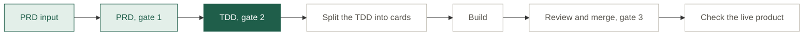

# sketch-gallery: project map

Every piece of this project, where it lives, and when it's used. Claude adds each new piece as soon as it exists, and checks the whole map after every merge, whenever a PR opens, at the end of each stage, and whenever someone asks where things stand.

The map exists in two places with the same content: `docs/MAP.md` in the GitHub repo, and the [map artifact](https://claude.ai/artifact/Pm6QZUibPcqXohWUKnVLSx) in Claude. Claude edits only `docs/MAP.md` and builds the map artifact from it.

**Now:** PRD approved (gate 1); TDD next

## GitHub
| Piece | What it is | When it's used |
|---|---|---|
| Repo: [hornof/sketch-gallery](https://github.com/hornof/sketch-gallery) | The code, docs and content | Every stage |
| Board: [sketch-gallery](https://github.com/users/hornof/projects/2) | Progress: one card per stage, then one card per piece of work from the TDD | Every stage |
| [Open PRs](https://github.com/hornof/sketch-gallery/pulls) | Work waiting for review or merge. GitHub keeps this list current. | Every stage |
| PRD input: [issue 2](https://github.com/hornof/sketch-gallery/issues/2) | The human PM's product details, which Claude used to write the first draft of the PRD | Start |
| [docs/PRD.md](PRD.md) | The Product Requirements Doc: what the site does and for whom, with mockup screenshots in docs/mockups/ | Approved at gate 1 |
| [docs/drawings.md](drawings.md) | The placeholder drawings: themes by year, samples, how they were made | PRD, then the build |
| [docs/STORY.md](STORY.md) | The project's turning points, one entry per stage | A new entry after each stage |
| [docs/MAP.md](MAP.md) | The map, in the repo. The map artifact is built from it. | Any time |
| [scripts/map-artifact.py](../scripts/map-artifact.py) | Builds the map artifact from `docs/MAP.md` | After every change to `docs/MAP.md` |
| Process: [hornof/apb](https://github.com/hornof/apb) | The steps this project follows, installed as a Claude Code plugin | Every stage |

## Claude artifacts
Web pages Claude makes and hosts on claude.ai. Each is private to its owner until shared. The kind is in brackets: a plain page is any web page Claude writes; a Design is a set of clickable screen mockups.

| Piece | What it is | When it's used |
|---|---|---|
| [Sketch Gallery Map](https://claude.ai/artifact/Pm6QZUibPcqXohWUKnVLSx) (plain page) | The map artifact. Built from `docs/MAP.md`; never edited by hand. | Any time |
| [Sketch Gallery mockups](https://claude.ai/artifact/BP1P6kU4J1Sg5cFvTqto7o) (Design) | Clickable designs of the main screens | PRD review (done) |
| [Placeholder Drawing Review](https://claude.ai/artifact/7DVZ6m3ZC6wztNZzgvbHci) (plain page) | Every placeholder drawing by year, newest year first, plus the ones set aside | While the drawings were made; reference |
| [Placeholder Drawing Trials](https://claude.ai/artifact/1o6uuCreKn6wVuCyqG5dHV) (plain page) | Six drawing sources compared, which led to choosing ChatGPT | Done; kept for the record |

## On the developer's computer
Folders, and scheduled tasks that run Claude unattended.

| Piece | What it is | When it's used |
|---|---|---|
| `~/src/claude/sketch-gallery` | Local copy of the repo | Every stage |
| `~/src/claude/sketch-gallery-placeholders` | Working folder for the drawings: one folder per year, files named by date, the original images, the set-aside ones, and the scripts that process them. `RUNBOOK.md` has the steps; `LOG.md` records every run. Not committed. | Making the drawings; the year folders get imported during the build |
| Scheduled task "Sketch gallery: next placeholder drawings" | Made the drawings in small batches, every 20 minutes | Done; paused |

## Outside services
| Piece | What it is | When it's used |
|---|---|---|
| ChatGPT | Made the placeholder drawings, driven by Claude in the developer's browser | Done |
| Cloudflare Pages | Free hosting for the site at `sketch-gallery.hornof.org` | Set up after the TDD |
| hornof.org projects page | An entry for this project once it's live | After launch |
