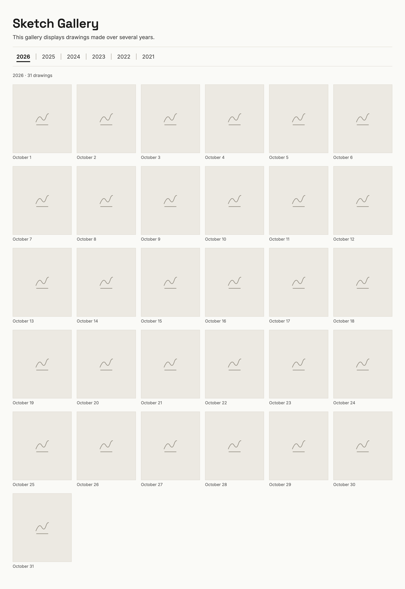
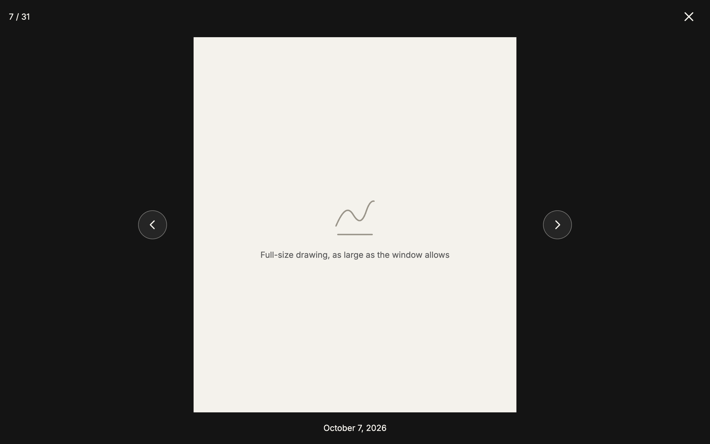
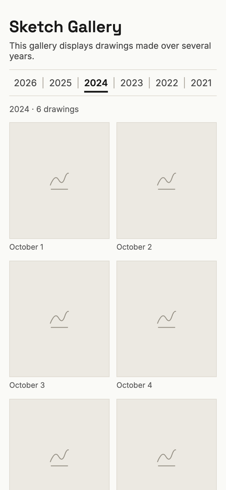
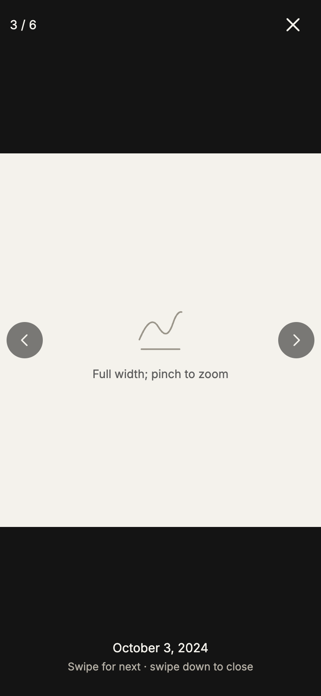

# PRD — sketch-gallery   (status: DRAFT, revision 3)

Source: brain dump on issue #2 (2026-11-10), Luke's review of PR #4 (2026-11-11), and decisions made with Luke on 2026-11-12.
Supporting files: [mockups](mockups/README.md) · [the drawings](drawings.md) · [drawing sources compared](research/drawing-sources.md).

## 1. What & why
A small public website that shows an artist's ink drawings, one gallery per year.

This repo is a **trial run**. A friend of Luke's, an Inktober artist, will build the real site with apb in a separate repo. Luke builds this one first to find and fix problems in apb. The trial site also goes on hornof.org as a portfolio project, so it must look good and be safe to show anyone.

The real artist's archive sets the shape of the trial: 6 years (2021–2026), portrait drawings, black ink on white. The trial uses **AI-generated placeholder drawings** in that spirit, never the artist's own (see section 7).

## 2. Goals and how we'll know
| Goal | Measure |
|---|---|
| Looks good enough for the hornof.org projects page | Luke signs off on the live site on a laptop and a phone |
| Pleasant to browse | Every check in section 5 passes on the live site |
| Shows how the owner keeps it up to date | Luke adds a drawing live in a demo, and it appears in its year within 5 minutes |
| Proves the apb process | The site is built card by card through apb, and every rough edge in the process is written down on [apb issue 2](https://github.com/hornof/apb/issues/2) |

## 3. Who it's for
- **Visitors:** anyone with the link, including people coming from the hornof.org projects page. No account, nothing to install.
- **Owner:** the artist (Luke stands in during the trial). Loads past years once, adds new drawings now and then, and demos adding one live.

## 4. User journeys
**A visitor browses**
1. Gets the link, `sketch-gallery.hornof.org`, in a message or from hornof.org. The link preview shows the site's title and a drawing (see open question 3).
2. Lands on the newest year: the title, one line of description, the year menu, and a grid of drawings with their dates.
3. Clicks a drawing. It grows from its thumbnail into a large view over a dark background.
4. Steps through the year with the arrow buttons, the keyboard arrows, or a swipe on a phone. Each step slides to the next drawing. At the first drawing there is no left arrow; at the last, no right arrow.
5. Closes the view (X, Esc, clicking the dark area, Back, or swiping down on a phone). The drawing shrinks back into the grid at the same spot.
6. Picks another year from the menu. The grid changes in place; the page doesn't reload or jump.
7. Can copy the address at any point to share that year or that exact drawing.

**The owner adds a drawing (the live demo)**
1. Has a new drawing as a JPEG, named by its date, for example `2026-11-03.jpg`.
2. Adds it with one step (how exactly is open question 1).
3. Within 5 minutes it appears on the live site, in its year, in date order. A new year appears in the menu by itself.

**The owner loads a past year**
1. Has a folder of one year's JPEGs, each named by date.
2. Imports the folder in one step. Within 5 minutes the whole year is live.

## 5. Requirements
Each requirement ends with the check that proves it.

### Visitor
1. **One page.** A title ("Sketch Gallery"), the line "This gallery displays drawings made over several years.", a year menu, and the drawings. The site names no artist and no person. *Check: the page text contains no personal names.*
2. **Year menu:** `2026 | 2025 | 2024 | 2023 | 2022 | 2021`, newest first, current year underlined. The newest year shows by default. Clicking a year **replaces** the drawings in place: no new page load, no jump down the page. *Check: clicking each year shows exactly that year's count (31, or 6 for 2024); the scroll position resets to the top of the grid.*
3. **Links per year and per drawing:** each year has its own URL (`/2025/`) and each drawing too (`/2025/#7`), so hornof.org or a message can link straight to one. Back and Forward move between years and open or closed drawings. *Check: pasting each URL into a fresh tab opens that year or that drawing.*
4. **Grid:** uniform portrait thumbnails in date order, each with its date ("October 7"). The grid has 2 columns at phone width and grows to 6 on a wide desktop. *Check: column count at 375, 768 and 1440 px is 2, 3–4 and 6.*
5. **Pop-up viewer:** clicking a thumbnail grows it into a large view over a dark background (a short zoom from the thumbnail). Closing it by X, Esc, a click on the dark area, Back, or a downward swipe on a phone shrinks it back to the same spot in the grid. *Check: each close method returns to the grid at the same scroll position.*
6. **Next and previous in the pop-up:** on-screen arrows, keyboard arrows, and swipe on a phone. All three **slide** to the next drawing with an animation; none swaps instantly. It stays within the year, and there is **no wraparound**: the first drawing has no left arrow, the last has no right arrow, and a swipe past either end bounces back. A counter reads "7 / 31" and a caption gives the full date ("October 7, 2026"). *Check: each gesture, forward and back, lands on the right drawing; the slide animation runs for the arrow buttons and keys, not only for swipe; the arrows hide at the ends.*
7. **Zoom on a phone:** pinch or double-tap zooms the full-size drawing, so fine lines and lettering are readable. *Check: on a 375 px screen, zooming reaches the image's full resolution.*
8. **Motion:** every animation finishes within 350 ms. When the device asks for reduced motion, the animations are switched off. *Check: timings measured; reduced motion honored.*
9. **Phone, tablet and desktop:** *Check: no horizontal scroll at 375, 768 or 1440 px; every button is at least 44 px; works in the current Safari, Chrome and Firefox, desktop and phone.*
10. **Fast:** *Check: a 31-drawing year is usable within 2 s on throttled "Fast 4G"; Lighthouse mobile performance ≥ 90; each thumbnail ≤ 60 KB (the site makes small thumbnails itself; the full-size files have no limit); the pop-up shows the original file at full resolution.*

### Owner
11. **Load a year:** one step takes a year's folder of JPEGs and makes it that year's gallery. Each file is named by its date, `YYYY-MM-DD.jpg`, and that name is the only source of the date: it sets the caption, the order and the link (`2025-10-07.jpg` → "October 7", `/2025/#7`). File timestamps are ignored. *Check: a 31-image folder is live within 5 min; a file not named `YYYY-MM-DD.jpg` is refused with a clear message.*
12. **Add one drawing:** one step adds a single dated JPEG, and creates the year if it is new. *Check: it is live within 5 min, in the right year and the right place; the other drawings are unchanged. This is the live demo.*
13. **Only the owner can change the gallery:** visitors can only look. *Check: someone without the owner's access cannot add, change or remove a drawing. How access works is open question 1.*

## 6. Design and UX
**Mockups:** five screens, saved in [`mockups/`](mockups/README.md). A clickable version is in Claude ([Sketch Gallery mockups](https://claude.ai/artifact/BP1P6kU4J1Sg5cFvTqto7o), private to Luke). The screens describe the look; gray tiles stand in for drawings.

| Desktop grid | Desktop pop-up | Phone grid | Phone pop-up |
|---|---|---|---|
|  |  |  |  |

**Look:** close to the [Bezsonova gallery](https://pdb101.rcsb.org/sci-art/bezsonova-gallery): quiet, so the drawings stand out.
- Warm off-white page with near-black text.
- The title in Space Grotesk, the rest in Inter.
- The current year underlined with a thick line, and thin rules above and below the year menu.
- Drawings on white tiles with a thin border, the date in small gray text below each.
- The pop-up: a near-black background, the drawing centered, the counter at top left, X at top right, round arrow buttons at the sides, and the date below.

**Motion:** the zoom in and out of the pop-up and the slide between drawings, each within 350 ms, and none when reduced motion is on (requirements 5, 6 and 8). The feel is like the demo gallery of PhotoSwipe, a common open-source viewer; the TDD picks the actual library.

**Accessibility:**
- Every control works from the keyboard and shows a visible focus ring.
- Every drawing has alt text: its date, plus its subject where known (for example "October 7, 2026: windmill").
- Text contrast meets WCAG AA.
- Buttons are at least 44 px.

**Things a visitor never sees:** an empty year (years without drawings aren't in the menu), a login, an error page for a missing drawing (a bad drawing link opens its year instead).

## 7. Content: the trial's drawings
- **161 AI-generated drawings, one theme per year:** Household items, Outdoors, Make-believe (2024, 6 drawings), Portraits, Architecture, Musical instruments. 31 in every other year.
- **Style:** one subject per drawing, black ink lines and hatching, plain white background, no color, no text, portrait shape. Portraits are invented people of varied ethnicity, age and build.
- **Made in ChatGPT** on Luke's subscription, chosen from six sources tried side by side ([comparison](research/drawing-sources.md)).
- **Year order:** once all six themes exist, Luke puts the most impressive in the most recent years. 2024 stays Make-believe.
- **No AI disclosure on the site;** the hornof.org projects page explains how it was built.
- The artist's own drawings are never in this repo or on the site.
- Every subject, the style rules and how the drawings were made and reviewed: [drawings.md](drawings.md).

## 8. Hosting and sharing
- **Address:** `sketch-gallery.hornof.org`, matching the repo name. Shareable on its own, and shown on the hornof.org projects page in the same viewer as eclipse, with "Open full screen" and "How it was built" links.
  - Options considered: the eclipse-style path `hornof.org/projects/sketch-gallery/` (every new drawing would also need a copy in the hornof.org repo); `sketch-gallery.pages.dev` (free, but looks unfinished); `sketch-gallery.com` (taken); `sketch-gallery.ai` ($160 up front).
- **Public:** anyone with the link can view. No accounts for visitors, no tracking or analytics.
- **Cost:** free (Cloudflare's free tier). The real artist picks a domain for the real site.

## 9. Not in this build
**Non-goals:**
- Visitor accounts, comments, likes, search, analytics.
- Selling prints, or more than one artist.
- Editing drawings in the browser, a database.
- Words per drawing (a "word of the day" caption may come later).

**Future work:** possible features to add later, if and when they're wanted.
- **Grid / List switch,** as on the Bezsonova gallery: a list view with one bigger drawing per row beside its date (mockup kept in [`mockups/future-desktop-list.png`](mockups/future-desktop-list.png)).
  - Small: about one card, for a second layout, the switch, and checks in both views.
  - Without words per drawing it adds little over the pop-up; showing each drawing's subject would give it a purpose.
- **"Generate drawings" for the owner:** pick a year or date range and a number, get new placeholder drawings named by date, and import them.
  - A ChatGPT subscription can't be used from a website. It needs a separate pay-as-you-go OpenAI API account: roughly $0.05–$0.21 per image by third-party figures, so about $1.50–$6.50 per 31-drawing year. Check current prices before building.
  - Doing it from the website needs server code and an owner login.
  - A laptop command that calls the API is the smaller version.

## 10. Risks and assumptions
- **ChatGPT limits:** generation pauses under its rate limit. Drawings that aren't ready are imported later, which also exercises requirement 11.
- **The real artist's files may differ:** different sizes or shapes, or not named by date. Requirement 11 refuses badly named files; the real site may need a renaming step.
- **The trial's placeholders are AI-made:** stated on hornof.org, not on the site.
- **Assumption:** Luke's laptop and GitHub account are the only places changes come from (unless open question 1 decides otherwise).

## 11. Decisions so far
| Question | Decision |
|---|---|
| Public or private | Public; linked from hornof.org |
| One gallery per year or per month | Per year; a short year (2024: 6) is fine |
| Text per drawing | The date only; no words for now |
| File type | JPEG, black and white or grayscale |
| Previous/next year links | Not needed; the year menu covers it |
| End of a year in the pop-up | No wraparound (requirement 6) |
| Grid / List switch | Future work |
| Where the drawings come from | ChatGPT, one theme per year (section 7) |
| Address | `sketch-gallery.hornof.org` (section 8) |

## 12. Open questions
1. **How the owner adds drawings, and who else can't.** The options:
   - **(a) Laptop command + GitHub:** one command checks the name and adds the file to the GitHub repo, and the site republishes itself in a minute or two. GitHub's login is the lock. Nothing on the site to log into.
   - **(b) Drag the file into the year's folder on github.com:** works from any device, same lock, nothing to build, but the name must be exactly right.
   - **(c) An owner page on the site, signed in with Google:** the nicest demo, but it needs server code and storage, so the site is no longer static files only. Roughly 2–4 extra cards.
   - **(d) An owner page with a password:** weakest. A shared password can leak or be guessed, and it needs the same server code as (c).

   Recommendation: (a), with (b) as a free backup; (c) as future work, since the real artist may want it.
2. **Dark mode:** follow the visitor's phone or computer setting (dark page, the drawings stay on white tiles), or always light? Recommendation: always light. The drawings are black on white, and a dark page around white tiles looks patchy.
3. **Link preview when shared:** when the link is pasted into a message or Slack, show the title, the description line and one drawing as the preview image? Recommendation: yes, using a fixed drawing that Luke picks.
