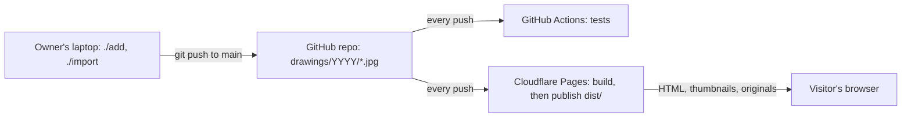

# TDD — sketch-gallery   (status: DRAFT)

How the site is built and tested, and the work split into issues. It follows the approved [PRD](PRD.md); "R5" means PRD requirement 5. Designed with the apb system design guide, at the "small project" level.

## 1. What the site does
- **A visitor:** opens a year, scrolls the grid, opens a drawing in the pop-up, steps through the year, closes it, picks another year, shares a link (R1–R10, R14).
- **The owner:** adds one drawing or a whole year from the laptop (R11, R12). Nobody else can change anything (R13).
- **Out of scope** (PRD section 9): accounts, comments, search, analytics, an upload page, a database, words per drawing.
- **Who runs it:** the human, from a laptop, with the Cloudflare dashboard and GitHub.

## 2. Rough numbers
| Number | Value | What it decides |
|---|---|---|
| Drawings | 161 now (6 years), about 31 more a year | All data fits in the repo; no database |
| Size of the originals | About 90 MB in all, up to 1.2 MB each | Fine in the repo and on Cloudflare Pages (limits: 20,000 files, 25 MB per file) |
| Thumbnails | 161, each at most 60 KB (R10) | Made at build time, not stored in the repo |
| Visitors | A few a day, more after a hornof.org post | Static hosting's free tier covers it many times over |
| Rebuilds | One per added drawing or import | Well under the free tier's 500 builds a month |

## 3. Stack
**Rung 1: static files on static hosting.** Every page is built ahead of time from the files in the repo. Nothing runs on a server, which is also what R13 asks for.

| Part | Choice | Why |
|---|---|---|
| Hosting | Cloudflare Pages, connected to the GitHub repo | Free; rebuilds on every push to main; a preview address for every PR; hornof.org's DNS is already on Cloudflare, so `sketch-gallery.hornof.org` is one step |
| Build | A Node script, `build/build.mjs`, writing to `dist/` | The site is 7 pages and a data list; a site generator adds nothing a 300-line script doesn't do |
| Thumbnails | `sharp` (image library) at build time, WebP format | Lowers quality step by step until each thumbnail is under 60 KB (R10) |
| Pop-up viewer | PhotoSwipe 5 | The PRD names its demo as the feel; it has the zoom from the thumbnail, swipe, pinch and double-tap zoom, keyboard keys, swipe down to close, and a no-wraparound mode (R5–R7) |
| Page code | Plain HTML, CSS and JavaScript, no framework | Year switching and links are about 150 lines of code |
| Fonts | Space Grotesk and Inter, served from the site itself | Loading them from Google would tell Google about every visitor; the PRD says no tracking |
| Owner tool | Node scripts, run as `./add` and `./import` from the repo folder | Same language as the build. The `./` matters: some computers already have a different program called `import` |
| Node version | 22, fixed in `package.json` and in the Pages settings | The same version on the laptop, in CI and on Cloudflare |

Rung 2 (adding server functions) isn't needed: nothing on the site takes input.

## 4. How it fits together

- **Adding a drawing:** `./add` checks the file, copies it to `drawings/2026/2026-11-03.jpg`, commits and pushes. Cloudflare sees the push, runs the build, and publishes in about 2 minutes.
- **Viewing:** the browser loads `/2026/`, which already has that year's grid in its HTML. Clicking a thumbnail loads the original into the pop-up.
- **Trust boundary:** the repo. Only people with write access to it can change anything. The site has no input from visitors at all.

## 5. Files and data
**In the repo:**
- `drawings/YYYY/YYYY-MM-DD.jpg`: the drawings. The file name is the only source of the date (PRD section 5).
- `drawings/subjects.csv`: optional, `date,subject`, used only for alt text ("October 7, 2026: windmill"). Missing subjects give date-only alt text.
- `site.json`: title, description line, the address, and which drawing the link preview shows (R14).

**Built into `dist/` (never committed):**
- `/index.html`: the newest year. `/2021/index.html` … `/2026/index.html`: one page per year.
- `/thumbs/YYYY/YYYY-MM-DD.webp`, `/full/YYYY/YYYY-MM-DD.jpg` (the original, copied as is), `/preview.jpg` (1200 × 630, for link previews).
- A small list of every year's drawings, built into each page, so switching years needs no extra download.

**One drawing, as the build sees it:**

| Field | Example | From |
|---|---|---|
| `date` | `2025-10-07` | The file name |
| `year`, `day` | `2025`, `7` | The date |
| `label` | "October 7" (grid), "October 7, 2025" (pop-up caption) | The date |
| `alt` | "October 7, 2025: windmill" | The date, plus `subjects.csv` if it has the date |
| `width`, `height` | `1440`, `1671` | Read from the file |

**Rules the build enforces, and stops on:** every file in `drawings/` matches `YYYY/YYYY-MM-DD.jpg` with a real date and the folder matching the year; every file really is a JPEG; no year folder is empty. When the build stops, Cloudflare keeps the last good version live, so a badly named file dragged in on github.com changes nothing (PRD section 4).

**Links:** a year is `/2025/`; a drawing is `/2025/#7`, where 7 is the day of the month (one drawing per date, so the day is unique within the year). A link to a day with no drawing opens the year (PRD section 6).

**History (R3):** picking a year adds a history entry. Opening a drawing adds one; closing it goes back. Stepping to the next drawing replaces the entry, so Back closes the pop-up instead of stepping back through every drawing.

## 6. Where data lives
| Data | Store | Backup | Loss we accept |
|---|---|---|---|
| Drawings and `subjects.csv` | The GitHub repo | GitHub, plus the owner's laptop copy | None after a push |
| Thumbnails, pages, preview image | Cloudflare Pages, rebuilt from the repo | Not needed: rebuilt on every push | All of it; the next build remakes it |
| Site settings (`site.json`) | The repo | GitHub | None |

Nothing is stored in a browser or on a server.

## 7. Quality targets
| Target | Value | How it's checked |
|---|---|---|
| Speed | A 31-drawing year usable within 2 s on throttled "Fast 4G"; Lighthouse mobile performance ≥ 90 (R10) | Lighthouse in CI on the built site; one check on the live site after launch |
| Thumbnail size | ≤ 60 KB each (R10) | The build stops if any is bigger; a test checks every thumbnail |
| Motion | Every animation ≤ 350 ms; none with reduced motion (R8) | Browser tests read PhotoSwipe's settings and time the animations |
| Uptime | Whatever Cloudflare gives | Not tested |
| Durability | The repo is the source of truth | Rebuild the site from a fresh clone once, before launch |
| Security | Visitors can only read; only people with repo write access can change anything (R13) | See section 9 |
| Cost | $0 a month; the domain is already paid for | Cloudflare and GitHub usage pages, once after launch |
| Rollback | Revert the commit, or pick an earlier deploy in the Cloudflare dashboard | Tried once before launch |

## 8. What could go wrong (risks)
| Risk | Effect | What we do | Check that catches it early |
|---|---|---|---|
| PhotoSwipe's arrow buttons or keys jump instead of sliding (R6 asks for a slide) | The pop-up doesn't feel as specified | Configure it, or add the slide ourselves | A browser test of the first pop-up issue times the slide for buttons and keys |
| Thumbnails can't reach 60 KB at a quality that looks good | R10 fails, or thumbnails look smudged | Smaller pixel size first, then lower quality | The build's size check, plus the human looks at the grid in the first pop-up issue's preview |
| A badly named file reaches main (dragged in on github.com) | The build stops | Cloudflare keeps the last good version live; CI also runs on main and names the file | A test with a badly named file shows the build stops with a clear message |
| `./add` commits, but the push fails (no network, no access) | The laptop and GitHub disagree | The tool undoes its commit and copy, then says what failed | A test that fakes a failed push |
| Pinch zoom can't be automated in tests | R7 untested in CI | Double-tap zoom is tested in CI; pinch is checked by hand on a real phone | The launch issue's checklist |

## 9. Security and secrets
- **Roles:** visitors read. The owner (anyone with write access to the repo) changes drawings. Nobody else can do anything.
- **Secrets: none.** Cloudflare Pages pulls from GitHub through its own GitHub connection, so no token is stored anywhere. The owner tool uses the laptop's own git login.
- **No input from visitors:** no forms, no upload, no server code (no `functions/` folder).
- **Headers** (a `_headers` file): a content security policy that allows only the site's own scripts, styles, fonts and images; no framing by other sites except hornof.org (for its projects-page viewer).
- **Tests:** the built site has no `<form>` and no `functions/` folder; the headers are present on the live site.

## 10. Cost
$0 a month on the free tiers of Cloudflare Pages and GitHub. The fastest-growing item is builds (one per added drawing), far below the 500-a-month limit.

## 11. Test plan
Tools:
- **Vitest** for unit tests.
- **fast-check** for property-based tests: a rule is tried against many random inputs.
- **Playwright** for browser tests in Chromium, Firefox and WebKit (Safari's engine), at phone, tablet and desktop sizes.
- **Lighthouse CI** for speed.
- **Stryker** for mutation testing: it plants small bugs to check the tests catch them. Used on the date, file-name and owner-tool code.

Browser tests run against the built site served locally in CI, using a small set of test drawings, so they don't depend on the real 161. After each merge, a smoke test runs against the live site.

| PRD | Test | Kind | Runs |
|---|---|---|---|
| R1 One page | Title and description present; the page text contains no personal names | Browser | CI |
| R2 Year menu | Menu shows 2026 … 2021 newest first, current year underlined; clicking each year shows exactly its count (31, or 6 for 2024) with no page load; scroll resets to the top of the grid | Browser | CI, plus the live smoke test |
| R3 Links | Each year URL and each drawing URL opens correctly in a fresh tab; Back and Forward move between years and open or closed drawings, in both directions; a link to a day with no drawing opens the year | Browser | CI |
| R4 Grid | Date order; labels like "October 7"; 2 columns at 375 px, 3–4 at 768 px, 6 at 1440 px | Browser | CI |
| R5 Pop-up | Each close method (X, Esc, dark area, Back, swipe down) returns to the grid at the same scroll position; the zoom starts from the thumbnail | Browser | CI |
| R6 Next and previous | Buttons, keys and swipe, forward and back, land on the right drawing; buttons and keys slide (timed); no arrows at the ends; a swipe past an end bounces back; counter "7 / 31" and caption "October 7, 2026" | Browser | CI |
| R7 Zoom on a phone | Double-tap zooms to full resolution at 375 px | Browser | CI; pinch by hand on a real phone at launch |
| R8 Motion | Every animation ≤ 350 ms; none when reduced motion is on | Browser | CI |
| R9 Devices | No horizontal scroll at 375, 768 and 1440 px; every button ≥ 44 px; whole suite in Chromium, Firefox and WebKit | Browser | CI |
| R10 Fast | Every thumbnail ≤ 60 KB; Lighthouse mobile ≥ 90; year usable within 2 s on Fast 4G; the pop-up loads the original file | Build check, Lighthouse, browser | CI, plus once on the live site |
| R11 Import | A 31-file folder is added in one commit; a folder with one bad name adds nothing and names that file; every problem is listed | Unit (property-based), plus the real import at launch | CI; live within 5 minutes, timed by hand |
| R12 Add | Adds in the right year and place; other drawings unchanged; an existing date refused without `--replace`; `--date` renames; a new year appears in the menu; the confirmation text and printed link match the PRD | Unit (property-based), plus the live demo | CI; live within 5 minutes, timed by hand |
| R13 Only the owner | The built site has no form and no server code; a push from an account without write access is refused (GitHub's own check, tried once by hand) | Build check, plus a manual check | CI; once before launch |
| R14 Link preview | The page has the title, description and preview-image tags, and the image exists | Build check | CI; iMessage and Slack by hand at launch |
| Accessibility (PRD section 6) | Every control works by keyboard with a visible focus ring; alt text on every drawing; AA contrast (axe, an accessibility checker) | Browser | CI |
| Always light (PRD section 6) | With the device in dark mode, the page stays light | Browser | CI |

Rules tested with random inputs:
- Any file name either parses to a real date or is refused with a message.
- Date → file name → date gives back the same date.
- Adding a drawing leaves every other drawing unchanged, and the year stays in date order.
- Every drawing in the built list has a thumbnail and an original, and every thumbnail and original belongs to a drawing in the list.
- `import` adds all of a folder or none of it.

## 12. Issues, in order
Each issue is one PR that works on its own, in this order.

1. **Setup proof.** A placeholder page built by `build/build.mjs`; CI runs the (tiny) test suite; Cloudflare Pages publishes main at `sketch-gallery.hornof.org` and gives each PR a preview address; README "Using it" filled in. The tiny change that proves every step works (TDD step 7 of apb).
2. **Drawings in, data out.** The build reads `drawings/`, enforces the file rules, makes thumbnails ≤ 60 KB, and writes the drawing list. Test drawings in `tests/fixtures/`. Covers part of R10 and the build-time half of R11 and R12.
3. **Year pages and grid.** `/YYYY/` pages and the home page; title, description, year menu, grid with dates; fonts, colors, always light; the column counts. R1, R2 (look), R4, R9.
4. **Switching years in place.** The menu changes the grid without reloading; year links and Back/Forward. R2, R3 (years).
5. **The pop-up.** PhotoSwipe opening from the thumbnail, every close method, double-tap zoom, motion limits, reduced motion. R5, R7, R8.
6. **Next, previous and drawing links.** Slide on buttons, keys and swipe; no wraparound; counter and caption; `/2025/#7` links and history. R6, R3 (drawings).
7. **Link preview, speed and headers.** Preview tags and image, Lighthouse ≥ 90 in CI, security headers. R10, R13 (site side), R14.
8. **`./add`.** Checks, confirmation, `--date`, `--replace`, `--yes`, commit and push, undo on failure. R12.
9. **`./import` and the real drawings.** Import all six years of placeholder drawings with the tool. R11.
10. **Launch checks.** The checks that need a person: a real phone (pinch, swipe), iMessage and Slack previews, a rebuild from a fresh clone, one rollback, the live demo of `./add` timed, and the human's sign-off on a laptop and a phone (PRD section 2).

The hornof.org projects-page entry is in a different repo, so it isn't an issue here. It comes after launch.
