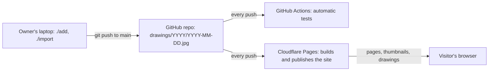

# TDD — sketch-gallery   (status: DRAFT)

How the site is built and tested, and the work split into a list of issues. It follows the approved [PRD](PRD.md).

"R1" to "R14" are the PRD's requirements, numbered as in PRD section 5. Each one's name is given next to it, like "R6 (next and previous)".

## 1. What the site does
- **A visitor:** opens a year, scrolls the grid, opens a drawing in the pop-up, steps through the year, closes it, picks another year, shares a link (R1 to R10 and R14, the visitor requirements).
- **The owner:** adds one drawing or a whole year from the laptop: R11 (load a year), R12 (add one drawing). Nobody else can change anything: R13 (only the owner).
- **Not in this build** (PRD section 9): accounts, comments, search, analytics, an upload page, a database, words per drawing.
- **Who looks after it:** the human, from a laptop, using GitHub and the Cloudflare website.

## 2. Rough numbers
| Number | Value | What it decides |
|---|---|---|
| Drawings | 161 now (6 years), about 31 more a year | Everything fits in the GitHub repo; no database |
| Size of the drawings | About 90 MB in all, up to 1.2 MB each | Fine for the repo and for Cloudflare Pages, which allows 20,000 files of up to 25 MB each |
| Thumbnails | One per drawing, each at most 60 KB (R10, fast) | Made automatically every time the site is rebuilt; never stored in the repo |
| Visitors | A few a day, more after a hornof.org post | Cloudflare's free plan covers it many times over |
| Rebuilds | One per push to GitHub, including pushes to a PR. A push with many drawings is still one rebuild | Well under the free plan's 500 a month |

## 3. Tools
**Plain files on a web host.** Every page is made ahead of time from the files in the repo, and nothing runs on a server. This is the simplest way to build a site, and it's all this one needs: visitors only look, and nothing on the site takes input from them (R13, only the owner).

| Part | Choice | Why |
|---|---|---|
| Hosting | Cloudflare Pages, connected to the GitHub repo | Free. Rebuilds the site by itself after every push to main, and gives every PR its own preview address. hornof.org's address settings are already on Cloudflare, so `sketch-gallery.hornof.org` takes one step to set up |
| Building the pages | A short program in Node (which runs JavaScript on a computer rather than in a browser), `build/build.mjs`, that writes the finished site into a `dist/` folder | The site is one page per year plus a home page; a ready-made site generator would add more than it saves |
| Thumbnails | `sharp`, an image library, run during the build | Makes each thumbnail as a WebP file (an image format like JPEG, but smaller), lowering the quality step by step until it's under 60 KB (R10, fast) |
| Pop-up | PhotoSwipe 5, an open-source pop-up viewer | The PRD names its demo as the feel. It has the zoom from the thumbnail, swiping, pinch and double-tap zoom, keyboard keys, swipe down to close, and a setting that stops at the first and last drawing. Covers R5 (pop-up), R6 (next and previous) and R7 (zoom on a phone) |
| Page code | Plain HTML, CSS and JavaScript, no ready-made toolkit | Switching years and handling links is about 150 lines |
| Fonts | Space Grotesk and Inter, stored on the site itself | Loading them from Google would let Google see every visitor; the PRD says no tracking |
| Owner commands | `./add` and `./import`, Node programs run from the repo folder on the laptop | Same language as the build. The `./` matters: some computers already have a different program called `import` |
| Node version | 22, written into `package.json` and the Cloudflare settings | The same version on the laptop, in the automatic tests and on Cloudflare |

**Pop-up settings we change from PhotoSwipe's defaults:**
- **Slide on buttons and keys.** PhotoSwipe slides to the next drawing only when you swipe. Clicking an arrow button or pressing an arrow key makes it jump with no animation. R6 (next and previous) asks for a slide every time, so we add a few lines that make the buttons and keys slide too.
- **Double-tap zooms to full size.** By default, a double-tap zooms to 2.5 times the screen-fitted size, which on a phone shows about two-thirds of the drawing's detail. We set it to zoom to the drawing's full size (R7, zoom on a phone).
- **Stop at the ends.** No going from the last drawing back to the first (R6, next and previous).
- **Thumbnails keep the drawing's shape**, so the zoom from thumbnail to pop-up lines up.

## 4. How it fits together

- **Adding a drawing:** `./add` checks the file, copies it to `drawings/2026/2026-11-03.jpg`, commits it and pushes it to GitHub. Cloudflare sees the push, rebuilds the site and publishes it, in about 2 minutes.
- **Viewing:** the browser loads `/2026/`, a page that already lists that year's drawings. Clicking a thumbnail loads the full drawing into the pop-up.
- **Who can change the site:** only people who can push to the GitHub repo. Visitors send nothing to the site.

## 5. Files and links
**In the repo:**
- `drawings/YYYY/YYYY-MM-DD.jpg`: the drawings, one folder per year. The file name is the only source of a drawing's date (PRD section 5).
- `site.json`: the title, the description line, the address, and which drawing the link preview shows (R14, link preview).

**Made by the build, never stored in the repo:**
- `/index.html`: the newest year. `/2021/index.html` … `/2026/index.html`: one page per year.
- `/thumbs/YYYY/YYYY-MM-DD.webp`: the thumbnails.
- `/full/YYYY/YYYY-MM-DD.jpg`: the drawings, at full size, with any hidden location removed. A photo taken with a phone usually records where it was taken; the build drops that. The picture itself is not changed, and the hidden note saying which way is up is kept, so browsers show it upright.
- `/preview.jpg`: the image shown in link previews (1200 × 630).
- A short list of every year's drawings, included in each page, so switching years needs no extra download.

**What the build knows about each drawing:**

| Detail | Example | Comes from |
|---|---|---|
| Date | `2025-10-07` | The file name |
| Year | `2025` | The date |
| Label under the thumbnail | "October 7" | The date |
| Caption in the pop-up | "October 7, 2025" | The date |
| Description for screen readers | "October 7, 2025" | The date |
| Width and height | `1440`, `1671` | The image itself, after turning it upright if the file says it was taken sideways (phone photos can) |

**The build stops if:** a file in a year folder isn't named `YYYY-MM-DD.jpg` with a real date; a file's year doesn't match its folder; a file isn't really a JPEG; or a year folder is empty. When the build stops, Cloudflare keeps the last good version of the site live. So a badly named file dragged in on github.com changes nothing on the site (PRD section 4).

**Links:**
- A year: `sketch-gallery.hornof.org/2025/`
- A drawing: `sketch-gallery.hornof.org/2025/#2025-10-07`. The year's page opens with that drawing in the pop-up. The part after `#` is the drawing's file name without `.jpg`, so two drawings can never share a link.
- A link to a date with no drawing opens the year (PRD section 6).
- An address for a year with no drawings, like `/2019/`: Cloudflare shows the home page, and the page changes the address to the year it shows, so a shared link never names the wrong year.

**Back and Forward (R3, links):** picking a year adds a step to the browser's history. Opening a drawing adds one, and closing it goes back. Moving to the next drawing doesn't add a step, so Back closes the pop-up instead of stepping back through every drawing.

**Loading thumbnails (R10, fast):** thumbnails on the screen load right away. The ones further down start loading shortly before you scroll to them.

## 6. Where data is kept
| Data | Kept in | Backup | If it's lost |
|---|---|---|---|
| Drawings and `site.json` | The GitHub repo | GitHub, plus the copy on the owner's laptop | Nothing is lost once pushed |
| Thumbnails, pages, preview image | Cloudflare Pages | Not needed | The next build makes them again |

Nothing is stored in a visitor's browser or on a server.

## 7. Targets
| Target | Value | How it's checked |
|---|---|---|
| Speed | A year with 31 drawings is usable within 2 seconds on a phone connection ("Fast 4G" in the browser's test settings); Lighthouse, Google's page-speed check, scores at least 90 on mobile (R10, fast) | Lighthouse runs in the automatic tests on every PR from issue 5 in section 12 (year pages and grid) on, and once on the live site |
| Thumbnail size | At most 60 KB each (R10, fast) | The build stops if any is bigger, and a test checks every thumbnail |
| Motion | Every animation finishes within 350 ms; none play when the device asks for less motion (R8, motion) | Browser tests time each animation |
| Uptime | Whatever Cloudflare gives | Not tested |
| Recovery | The repo holds everything | Rebuild the site from a fresh copy of the repo once, before launch |
| Security | Visitors can only look; only people with push access to the repo can change anything (R13, only the owner) | See section 9 |
| Cost | $0 a month; the domain is already paid for | The Cloudflare and GitHub usage pages, once after launch |
| Undoing a bad release | Undo the commit, or pick an earlier version in Cloudflare | Tried once before launch |

## 8. What could go wrong
| Problem | Effect | What we do | How we catch it early |
|---|---|---|---|
| Thumbnails can't get under 60 KB and still look good | R10 (fast) fails, or thumbnails look smudged | Make them fewer pixels first, then lower the quality | The build's size check, and the human looks at the grid with the real drawings in the preview of issue 5 in section 12 (year pages and grid) |
| A badly named file reaches main, for example dragged in on github.com | The build stops | Cloudflare keeps the last good version live; the automatic tests on main name the bad file | A test with a badly named file checks that the build stops with a clear message |
| `./add` can't push, for example no network, or someone added a drawing on github.com since the last pull | The laptop and GitHub disagree | `./add` first pulls the latest version from GitHub. If the push still fails, it undoes its commit and copy and says what went wrong | Tests that fake a failed push and a changed main |
| Pinch zoom can't be tested automatically | R7 (zoom on a phone) isn't fully covered by the automatic tests | Double-tap zoom is tested automatically; pinch is checked by hand on a real phone | Issue 10 in section 12 (launch checks) |

## 9. Security
- **Who can do what:** visitors look. The owner, anyone with push access to the repo, adds or replaces drawings. Nobody else can change anything.
- **No passwords or keys to keep safe.** Cloudflare reads the repo through its own connection to GitHub, and the owner commands use the laptop's own GitHub login.
- **Nothing for visitors to send:** no forms, no upload, no server code.
- **Browser rules sent with every page** (a `_headers` file):
  - Run only code that comes from this site. This stops code from other sites from running on ours.
  - Only hornof.org may show the site inside its own page (for the projects-page viewer).
- **Tests:** the site has no form and no server code, and the browser rules are present on the live site.

## 10. Cost
$0 a month on the free plans of Cloudflare Pages and GitHub. The thing that grows fastest is rebuilds, one per push to GitHub, far below the 500-a-month limit.

## 11. Test plan
**Tools:**
- **Vitest** runs small tests of single functions, like turning a file name into a date.
- **fast-check** tries a rule against many random inputs, for example every possible file name.
- **Playwright** drives real browsers through the site: Chromium (Chrome's engine), Firefox and WebKit (Safari's engine), at phone, tablet and desktop sizes.
- **Lighthouse** measures page speed.
- **Stryker** puts small deliberate bugs into the code and checks that a test catches each one. Used on the date, file-name and owner-command code.

Browser tests run on the built site in the automatic tests, using the real drawings once they're in the repo. **No test assumes how many drawings a year has.** Any year can change, because `./add --date` and `./import` can add drawings to past years. Tests count the drawings in the repo and check that the site shows exactly that many. After each merge, a quick check runs against the live site.

| Requirement | Test | Kind | Runs |
|---|---|---|---|
| R1 (one page) | Title and description are there; the page names no person | Browser | Every PR |
| R2 (year menu) | Years newest first, the current one underlined; clicking each year shows exactly the drawings in its folder, without loading a new page; the page scrolls back to the top of the grid | Browser | Every PR, and on the live site |
| R3 (links) | Each year link and each drawing link opens correctly in a new tab; Back and Forward move between years and between open and closed drawings, in both directions; no two drawings in a year share a link; a link to a date with no drawing opens the year; an address for a year with no drawings shows the newest year under its own address | Browser, plus a test of the link list | Every PR |
| R4 (grid) | Date order; labels like "October 7"; 2 columns at 375 px wide, 3–4 at 768 px, 6 at 1440 px | Browser | Every PR |
| R5 (pop-up) | Opens with a zoom from the thumbnail; each way of closing (X, Esc, clicking the dark area, Back, swiping down) returns to the grid at the same place | Browser | Every PR |
| R6 (next and previous) | Buttons, keys and swipes, forward and back, reach the right drawing; buttons and keys slide; no arrows at the ends; a swipe past an end springs back; counter "7 / 31" and caption "October 7, 2026" | Browser | Every PR |
| R7 (zoom on a phone) | Double-tap at 375 px wide zooms to the drawing's full size | Browser | Every PR; pinch by hand on a real phone at launch |
| R8 (motion) | Every animation, including the slide on buttons and keys, finishes within 350 ms; none play when the device asks for less motion | Browser | Every PR |
| R9 (phone, tablet and desktop) | No sideways scrolling at 375, 768 and 1440 px; every button at least 44 px; all browser tests pass in Chromium, Firefox and WebKit | Browser | Every PR |
| R10 (fast) | Every thumbnail at most 60 KB; Lighthouse mobile score at least 90; a year usable within 2 seconds on Fast 4G; the pop-up shows the full-size drawing | Build check, Lighthouse, browser | Every PR, and once on the live site |
| R11 (load a year) | One or more folders are added in one commit and one push; one badly named file in any folder adds nothing from any folder and names that file; every problem is listed | Function tests with random inputs, plus the human loading the real drawings | Every PR; the real load is timed by hand |
| R12 (add one drawing) | Lands in the right year and place; other drawings unchanged; an existing date refused without `--replace`; `--date` renames the file; a new year appears in the menu; the message and printed link match the PRD | Function tests with random inputs, plus the live demo | Every PR; live within 5 minutes, timed by hand |
| R13 (only the owner) | The site has no form and no server code; a push from an account without access is refused (GitHub's own check, tried once by hand) | Build check, plus a check by hand | Every PR; once before launch |
| R14 (link preview) | The page has the title, description and preview image, and the image exists | Build check | Every PR; iMessage and Slack by hand at launch |
| Accessibility (PRD section 6) | Everything works with the keyboard (Tab moves between the years and drawings, Enter opens one); the item Tab has reached shows a visible ring; every drawing has a description for screen readers; text is dark enough to read easily (checked with axe, an accessibility checker) | Browser | Every PR |
| Never shown to a visitor (PRD section 6) | A year with no drawings isn't in the menu (the build refuses an empty year folder); there's no login anywhere; a bad drawing link opens its year instead of an error page | Build check and browser | Every PR |
| Always light (PRD section 6) | With the device set to dark mode, the page stays light | Browser | Every PR |
| Phone photos (section 5) | A test drawing made like a sideways phone photo with a location in it: its thumbnail is upright, the list has its upright width and height, and the full-size copy has no location but still shows upright | Build check | Every PR |

**Rules tried against many random inputs:**
- Any file name either becomes a real date or is refused with a message.
- Turning a date into a file name and back gives the same date.
- Adding a drawing leaves every other drawing unchanged, and the year stays in date order.
- Every drawing in the list has a thumbnail and a full-size file, and every thumbnail and full-size file belongs to a drawing in the list.
- `./import` adds all of the folders it's given, or none of them.

## 12. Issues, in order
Once this TDD is approved, each item below becomes a GitHub issue on the board. Each one is a single PR that works on its own, built in this order.

1. **Setup proof.** A placeholder page made by `build/build.mjs`; automatic tests on every PR; Cloudflare Pages publishing main at `sketch-gallery.hornof.org` and giving each PR a preview address; README's "Using it" section filled in. One tiny change sent through every step to prove it all works (step 7 of the apb TDD skill).
2. **Drawings in, site data out.** The build reads `drawings/`, enforces the file rules, turns phone photos upright for the thumbnails, removes location from the full-size copies, makes thumbnails of at most 60 KB that keep the drawing's shape, and writes the list of drawings. A few test drawings in `tests/fixtures/` until the real ones arrive. Part of R10 (fast), and the build side of R11 (load a year) and R12 (add one drawing).
3. **`./add`.** Pulls the latest version first; checks the file; says what it will do and asks for a yes; `--date`, `--replace` and `--yes`; commits and pushes; prints the drawing's link (for example `sketch-gallery.hornof.org/2026/#2026-11-03`); undoes everything if the push fails. R12 (add one drawing).
4. **`./import`.** Adds one or more year folders in a single commit and push, so loading all six years is one rebuild. All or nothing across every folder. After this PR is merged, the human runs it from the repo folder on the laptop to load the 161 placeholder drawings, which are in a folder next to the repo:
   `./import ../sketch-gallery-placeholders/2021 ../sketch-gallery-placeholders/2022 ../sketch-gallery-placeholders/2023 ../sketch-gallery-placeholders/2024 ../sketch-gallery-placeholders/2025 ../sketch-gallery-placeholders/2026`
   The human times it against R11 (load a year: live within 5 minutes), so every later preview shows the real drawings and the command gets a real first use. R11 (load a year).
5. **Year pages and grid.** `/YYYY/` pages and the home page; title, description, year menu, grid with dates; fonts and colors, always light; the column counts; thumbnails loading as described in section 5; descriptions for screen readers, the keyboard ring and readable text in the grid; Lighthouse added to the automatic tests. R1 (one page), R2 (year menu, its look), R4 (grid), R9 (phone, tablet and desktop), part of R10 (fast).
6. **Switching years in place.** The menu changes the grid without loading a new page; year links; Back and Forward between years; the address fix for a year with no drawings. R2 (year menu), R3 (links, for years).
7. **The pop-up.** PhotoSwipe opening with a zoom from the thumbnail; every way of closing, including Back (opening a drawing adds a history step); double-tap to full size; animation times; no animation when the device asks for less motion; keyboard use in the pop-up. R5 (pop-up), R7 (zoom on a phone), R8 (motion).
8. **Next, previous and drawing links.** The slide on buttons, keys and swipes, timed against 350 ms and switched off when the device asks for less motion; stopping at the ends; counter and caption; drawing links like `/2025/#2025-10-07`. R6 (next and previous), R3 (links, for drawings), R8 (motion).
9. **Link preview and browser rules.** The preview title, description and image; the `_headers` rules. R13 (only the owner, on the site), R14 (link preview).
10. **Launch checks.** The checks that need a person: a real phone (pinch, swipe), iMessage and Slack previews, a rebuild from a fresh copy of the repo, undoing one release, the live demo of `./add` timed, and the human's sign-off on a laptop and a phone (PRD section 2).

The hornof.org projects-page entry is in a different repo, so it isn't on this list. It comes after launch.
