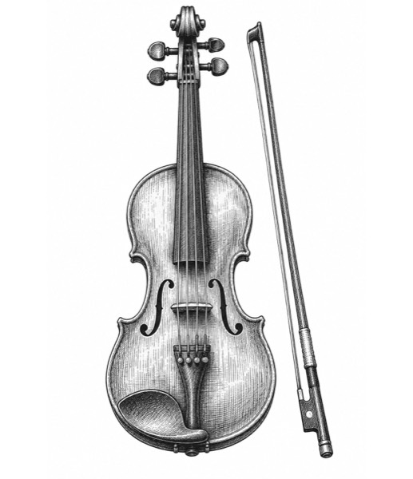
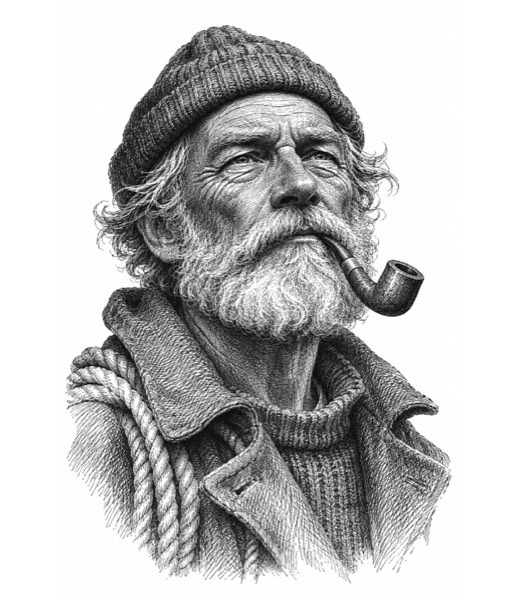
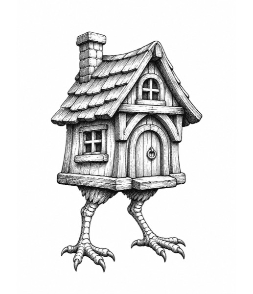
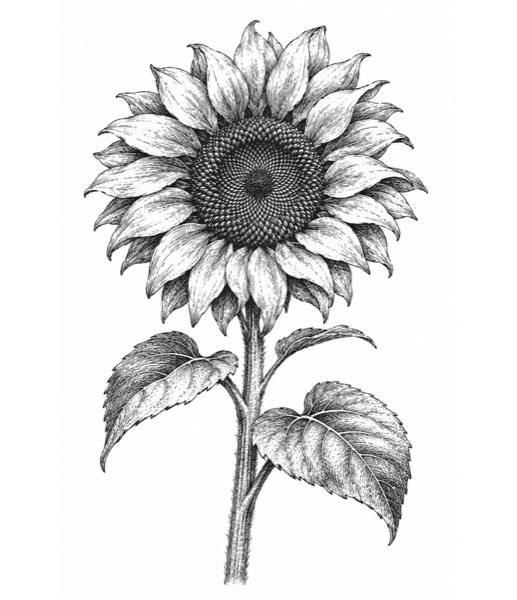
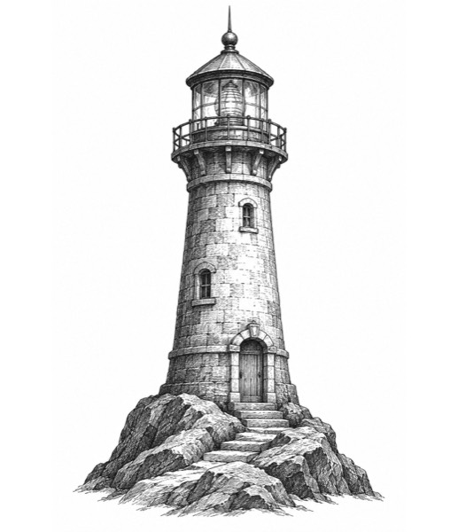
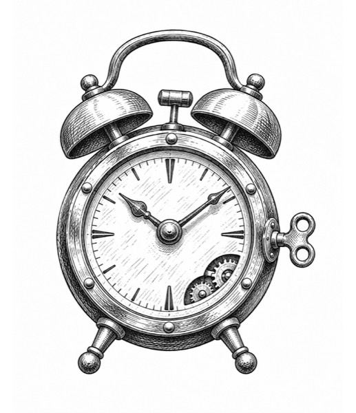

# The placeholder drawings

Supporting detail for the PRD's Content section. The PRD says *what* the drawings are; this file is the full record.

These are **stand-ins**. The real artist's site (a separate repo) uses the artist's own drawings. None of the artist's
images are in this repo; two of them were used only as a style reference and stay on Luke's laptop.

## Style rules
Every drawing follows these, and drawings that broke them were redone:
- One subject per drawing: an object, a building, an instrument or a person. Never a collage or a scene.
- Black ink lines and hatching only, hand-inked rather than glossy. No color.
- Pure white background, with nothing behind the subject beyond a little ground.
- No text, signatures or labels (letters that are part of the object, like N/S/E/W on a weather vane, are fine).
- Portrait (tall) orientation.
- Portraits are invented people, never real or famous ones. They vary in ethnicity, age and build, and wear plain everyday clothes rather than costumes.

## How they're made
- **Tool:** ChatGPT, on Luke's subscription, driven by Claude in Luke's Chrome. Why ChatGPT: see [research/drawing-sources.md](research/drawing-sources.md).
- **Style references:** two of the artist's drawings (a hand and a button) and five early ChatGPT results (key, teapot, moka pot, backpack, a brass instrument).
- **Processing:** grayscale, scaled to fit 1440 × 1671 px and padded with white (never cropped), saved as JPEG.
- **Dates:** each drawing's made-up date is its filename, `YYYY-MM-DD.jpg`. Each year runs October 1 through N.
- **Review:** every drawing was checked by Claude and then by Luke. Rejected ones were redone: the button's stripes copied onto objects, glossy versions, cream paper, landscape shapes, collages made under ChatGPT's rate limit, and two people in one picture.
- **Rate limit:** ChatGPT allowed about 150 images in 3 hours, then asked for 2–4 minute pauses; later it sometimes refused until a reset time it named, an hour or more away. The last two themes made (Architecture and Musical instruments) came from a scheduled task, 4 drawings every 20 minutes.

## Year order
Each year has one theme. Luke put the most impressive themes in the most recent years, because the site shows the
newest year first: 2026 Musical instruments, 2025 Portraits, 2024 Make-believe (the real archive has 6 drawings that
year), 2023 Outdoors, 2022 Architecture, 2021 Household items. Moving a theme to another year only renames its files.

## Themes and subjects

### 2026: Musical instruments (31 drawings)

| Date | Subject |
|---|---|
| 2026-10-31 | tuba |
| 2026-10-30 | erhu |
| 2026-10-29 | koto |
| 2026-10-28 | banjo |
| 2026-10-27 | harp |
| 2026-10-26 | tabla |
| 2026-10-25 | kora |
| 2026-10-24 | sitar |
| 2026-10-23 | bagpipes |
| 2026-10-22 | didgeridoo |
| 2026-10-21 | saxophone |
| 2026-10-20 | mandolin |
| 2026-10-19 | cello |
| 2026-10-18 | balalaika |
| 2026-10-17 | oud |
| 2026-10-16 | darbuka |
| 2026-10-15 | French horn |
| 2026-10-14 | djembe |
| 2026-10-13 | gamelan gong |
| 2026-10-12 | steel drum |
| 2026-10-11 | clarinet |
| 2026-10-10 | ukulele |
| 2026-10-09 | trumpet |
| 2026-10-08 | guzheng |
| 2026-10-07 | kalimba |
| 2026-10-06 | pan flute |
| 2026-10-05 | violin and bow |
| 2026-10-04 | acoustic guitar |
| 2026-10-03 | charango |
| 2026-10-02 | shamisen |
| 2026-10-01 | accordion |

### 2025: Portraits (31 drawings)

Luke picked these 31 from 45 and locked this random order.

| Date | Subject |
|---|---|
| 2025-10-31 | young man with curly hair |
| 2025-10-30 | Korean woman in her 20s with a straight bob |
| 2025-10-29 | farmer in a straw hat |
| 2025-10-28 | painter in a beret |
| 2025-10-27 | Middle Eastern woman in her 40s, dark curly hair |
| 2025-10-26 | Chinese grandmother with laugh lines |
| 2025-10-25 | Native American woman in her 60s, long gray hair |
| 2025-10-24 | blacksmith in a leather apron |
| 2025-10-23 | ringmaster in a top hat |
| 2025-10-22 | Native Hawaiian man, broad-shouldered |
| 2025-10-21 | Filipino boy, about 8 |
| 2025-10-20 | middle-aged West African woman, full-figured |
| 2025-10-19 | woman in a headscarf |
| 2025-10-18 | Black teenage girl with natural curly hair |
| 2025-10-17 | Mexican grandfather with a white mustache |
| 2025-10-16 | Indian man in his 50s, mustache, heavier build |
| 2025-10-15 | ballet dancer with her hair in a bun |
| 2025-10-14 | elderly Black man, thin, gray stubble, glasses |
| 2025-10-13 | elderly Japanese man, thin, bald |
| 2025-10-12 | elderly woman with reading glasses |
| 2025-10-11 | smiling old woman |
| 2025-10-10 | man with round spectacles and a mustache |
| 2025-10-09 | woman with braided hair |
| 2025-10-08 | young Indian woman with a nose stud |
| 2025-10-07 | old man with a long white beard |
| 2025-10-06 | cowboy with a bandana |
| 2025-10-05 | freckled boy in a cap |
| 2025-10-04 | young Ethiopian man, slender |
| 2025-10-03 | grandmother in a shawl |
| 2025-10-02 | laughing girl |
| 2025-10-01 | old sailor with a pipe |

### 2024: Make-believe (6 drawings)

| Date | Subject |
|---|---|
| 2024-10-06 | wizard's hat with stars |
| 2024-10-05 | walking house on chicken legs |
| 2024-10-04 | dragon egg |
| 2024-10-03 | winged teapot |
| 2024-10-02 | potion bottle with tiny ship inside |
| 2024-10-01 | clockwork beetle |

### 2023: Outdoors (31 drawings)

| Date | Subject |
|---|---|
| 2023-10-31 | cattails |
| 2023-10-30 | rope ladder |
| 2023-10-29 | kite |
| 2023-10-28 | spade |
| 2023-10-27 | thistle |
| 2023-10-26 | garden gate |
| 2023-10-25 | watering trough |
| 2023-10-24 | picnic basket |
| 2023-10-23 | birdhouse |
| 2023-10-22 | compass |
| 2023-10-21 | camp stove |
| 2023-10-20 | tent |
| 2023-10-19 | seashell |
| 2023-10-18 | feather |
| 2023-10-17 | rock with lichen |
| 2023-10-16 | sunflower |
| 2023-10-15 | tree stump with axe |
| 2023-10-14 | fishing reel |
| 2023-10-13 | weather vane |
| 2023-10-12 | beehive |
| 2023-10-11 | lantern on a hook |
| 2023-10-10 | canoe paddle |
| 2023-10-09 | hiking boot |
| 2023-10-08 | wheelbarrow |
| 2023-10-07 | garden gnome |
| 2023-10-06 | fallen log with moss |
| 2023-10-05 | snail shell |
| 2023-10-04 | bird's nest with eggs |
| 2023-10-03 | mushroom cluster |
| 2023-10-02 | acorn and oak leaf |
| 2023-10-01 | pine cone |

### 2022: Architecture (31 drawings)

| Date | Subject |
|---|---|
| 2022-10-31 | Korean hanok house |
| 2022-10-30 | lighthouse on a rock |
| 2022-10-29 | cathedral door |
| 2022-10-28 | stone well |
| 2022-10-27 | igloo |
| 2022-10-26 | domed observatory |
| 2022-10-25 | thatched cottage |
| 2022-10-24 | bell tower |
| 2022-10-23 | gazebo |
| 2022-10-22 | Indian stepwell |
| 2022-10-21 | West African mud-brick mosque |
| 2022-10-20 | Chinese ceremonial gate |
| 2022-10-19 | windmill |
| 2022-10-18 | Victorian house |
| 2022-10-17 | clock tower |
| 2022-10-16 | castle tower |
| 2022-10-15 | narrow canal house |
| 2022-10-14 | water tower |
| 2022-10-13 | arched stone bridge |
| 2022-10-12 | old barn |
| 2022-10-11 | ruined temple columns |
| 2022-10-10 | Moroccan arched doorway with tilework |
| 2022-10-09 | pagoda |
| 2022-10-08 | arched stone gateway |
| 2022-10-07 | log cabin |
| 2022-10-06 | Inca stone doorway |
| 2022-10-05 | Thai temple roof |
| 2022-10-04 | Mayan step pyramid |
| 2022-10-03 | Japanese castle |
| 2022-10-02 | treehouse |
| 2022-10-01 | covered bridge |

### 2021: Household items (31 drawings)

| Date | Subject |
|---|---|
| 2021-10-31 | fountain pen |
| 2021-10-30 | old camera |
| 2021-10-29 | hourglass |
| 2021-10-28 | pepper mill |
| 2021-10-27 | oil can |
| 2021-10-26 | coffee grinder |
| 2021-10-25 | reading glasses |
| 2021-10-24 | measuring tape |
| 2021-10-23 | box of matches |
| 2021-10-22 | padlock |
| 2021-10-21 | bicycle bell |
| 2021-10-20 | flower vase |
| 2021-10-19 | typewriter |
| 2021-10-18 | broom |
| 2021-10-17 | slippers |
| 2021-10-16 | glass bottle with cork |
| 2021-10-15 | pocket radio |
| 2021-10-14 | kettle |
| 2021-10-13 | sewing machine |
| 2021-10-12 | hand mirror |
| 2021-10-11 | candle in a holder |
| 2021-10-10 | umbrella |
| 2021-10-09 | wooden chair |
| 2021-10-08 | teacup and saucer |
| 2021-10-07 | cast-iron skillet |
| 2021-10-06 | rotary telephone |
| 2021-10-05 | toaster |
| 2021-10-04 | desk lamp |
| 2021-10-03 | pair of scissors |
| 2021-10-02 | metal watering can |
| 2021-10-01 | wind-up alarm clock |

