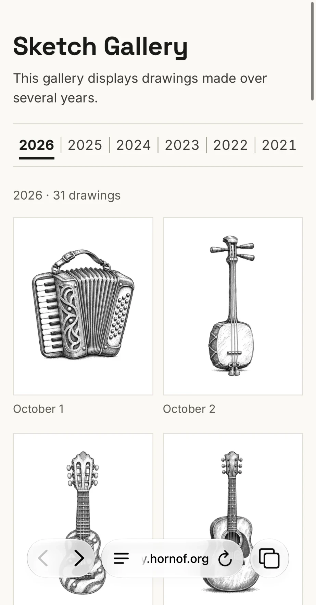
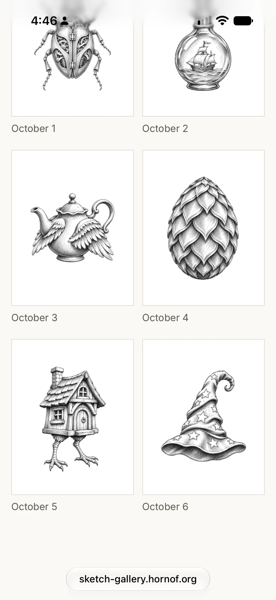
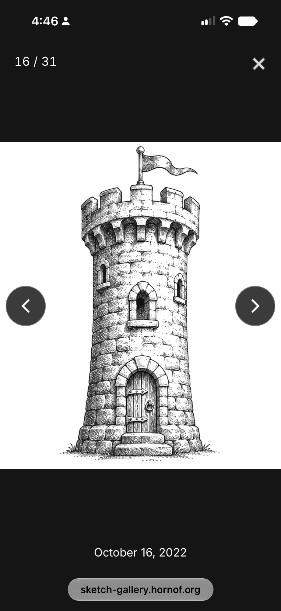
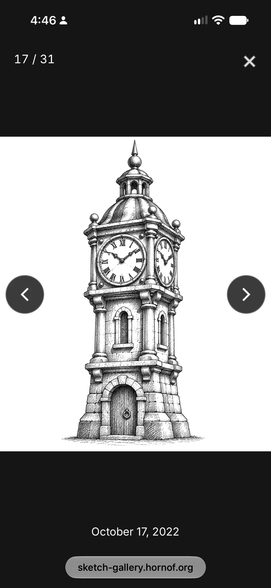
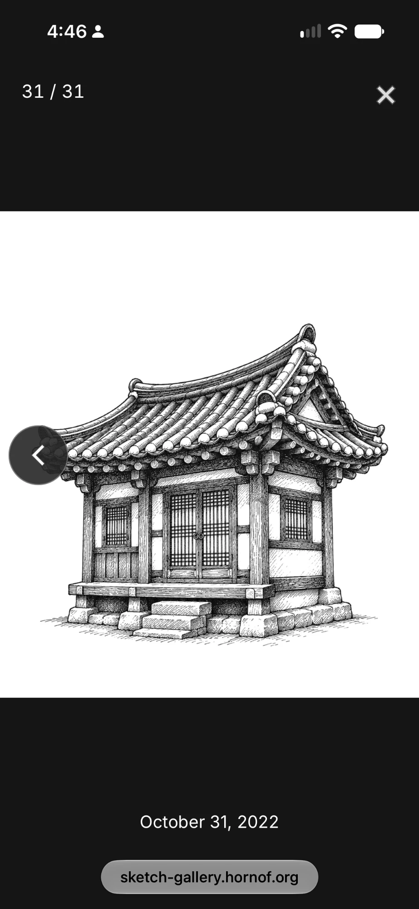

# Launch checks (#21)

The checks done at launch: the ones that need a person (the TDD's section 12, item 10), plus Lighthouse on the live site (R10, fast) and the refused push (R13, only the owner) from the TDD's test plan. Each line says who checked it, when, and what was seen.

| Check | Result | Who, when |
|---|---|---|
| Rebuild from a fresh copy of the repo | Passed: 161 drawings, every year page, the pop-up files, fonts, `preview.jpg` and `_headers`; site tests 206/206 in that copy | Claude, 2026-11-15, main at e945e7a |
| Speed on the live site (Lighthouse, mobile, median of 3 runs) | Passed: speed 100 for home, 100 for 2024 and 98 for 2025 (target: 90 or more); accessibility 100 on all three | Claude, 2026-11-15, main at e945e7a |
| iMessage link preview | Passed: the whole drawing, the title "Sketch Gallery" and the address | The human, 2026-11-15 |
| A real phone (iPhone), which is also the human's sign-off on a phone: years, thumbnails, full size, pinch to zoom, next and previous, no Next arrow on the last drawing | Passed: "iPhone looks amazing" | The human, 2026-11-15, main at ebf5fb8 |
| Slack link preview | Skipped by the human | |
| The live demo of `./add`, timed | To do | |
| Undoing one release | To do | |
| A push from an account without access is refused | To do | |
| Sign-off on a laptop | To do | |

## iPhone screenshots (2026-11-15)

| | | |
|---|---|---|
|  |  |  |
| Home page and year menu | A year's grid | The pop-up, with counter and date |
|  |  |  |
| Pinch to zoom | Next drawing | The last drawing: no Next arrow |
