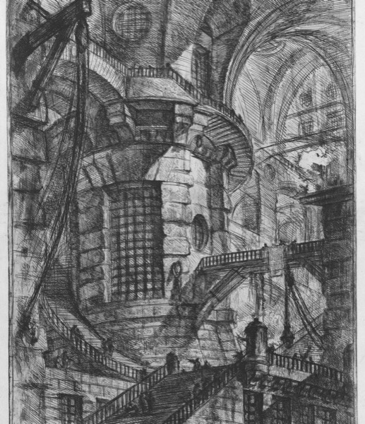
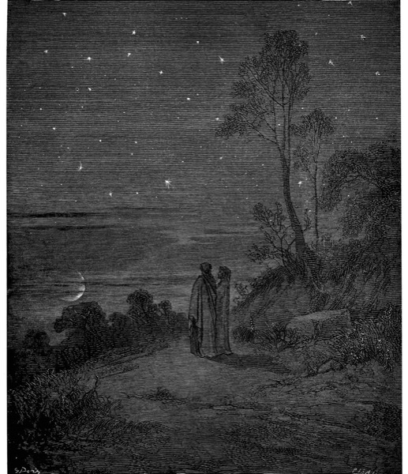
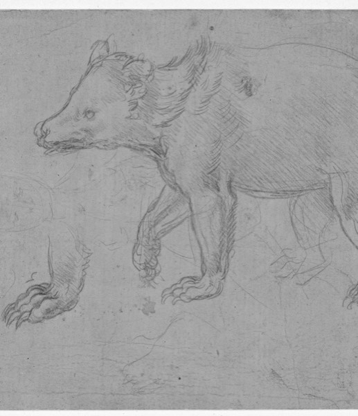
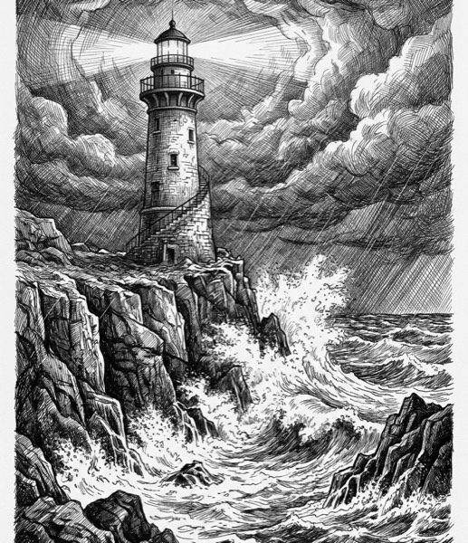
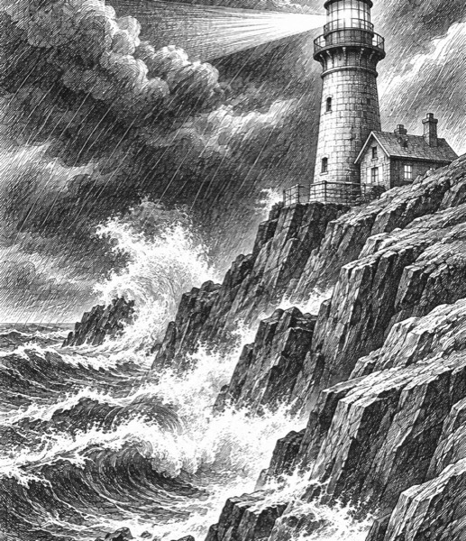
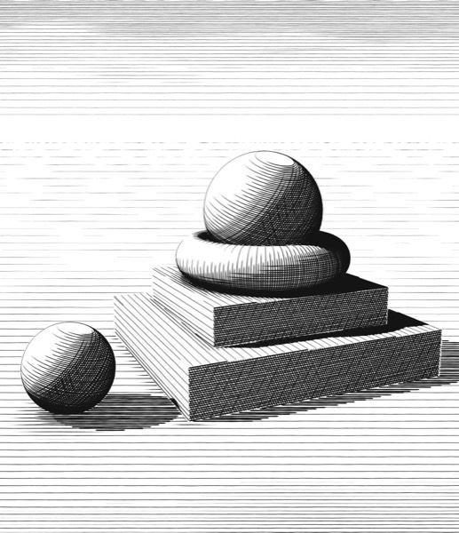
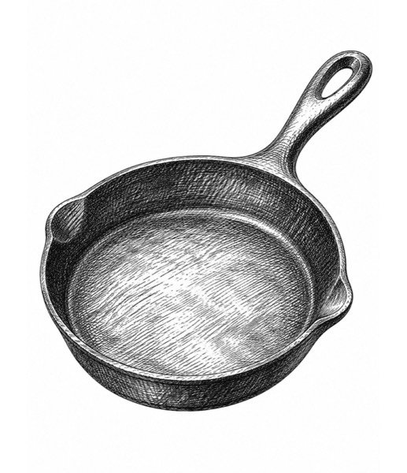

# Where the placeholder drawings came from: six sources compared

On 2026-11-11 and 11-12 we tried six ways to get 160 drawings that look like ink sketches and all look alike.
Each source got three samples, cropped and grayscaled the same way and shown side by side in the gallery's own layout.
One sample of each is below.

| Source | Sample | What it is | Verdict |
|---|---|---|---|
| **Piranesi** |  | 1750s etchings, "Imaginary Prisons", from the Met (CC0, free to use) | Very consistent pure line hatching, but only 16 plates in the series, and they're dense scenes, not single drawings |
| **Doré** |  | 1857 wood engravings for Dante's Inferno, public domain | Dramatic, but many plates have nude figures; picking 160 would take care |
| **Leonardo** |  | Drawings from about 1480–1510, public domain | Chalk on tinted paper comes out gray and faint; good scans are rare |
| **Gemini** |  | Made in Luke's Gemini account | Sharp and large, but cream paper and one image per request; it once claimed images it didn't make |
| **ChatGPT, scenes** |  | Made in Luke's ChatGPT account from the same scene prompts | Good, a little soft |
| **Drawn in code** |  | A Python program Claude wrote, drawing every hatch line | Fully original, but each new subject is real work, so 160 different ones isn't practical |

## What won: ChatGPT, one object on white

Luke tried a different prompt in ChatGPT: two of the real artist's drawings as a style reference, and "one hand-drawn
object, no background". The result beat every sample above. It's consistent, it can draw any subject (so 160 different
ones is realistic), and it lands on a clean white background that fits the gallery's white tiles. Gemini was tried with
the same references and was close, but slower and on cream paper.

The full rules and every subject are in [../drawings.md](../drawings.md).
